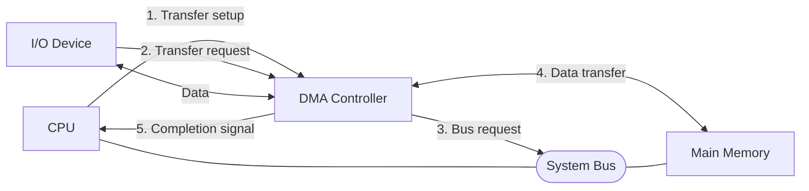
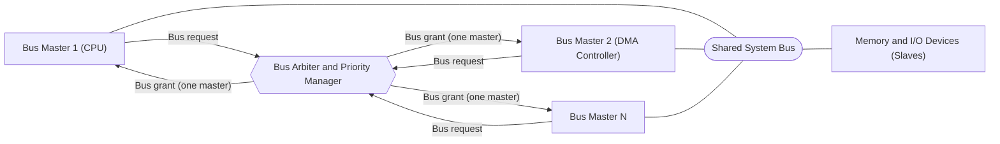
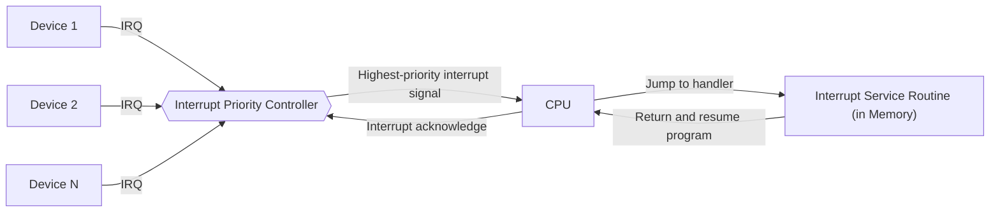
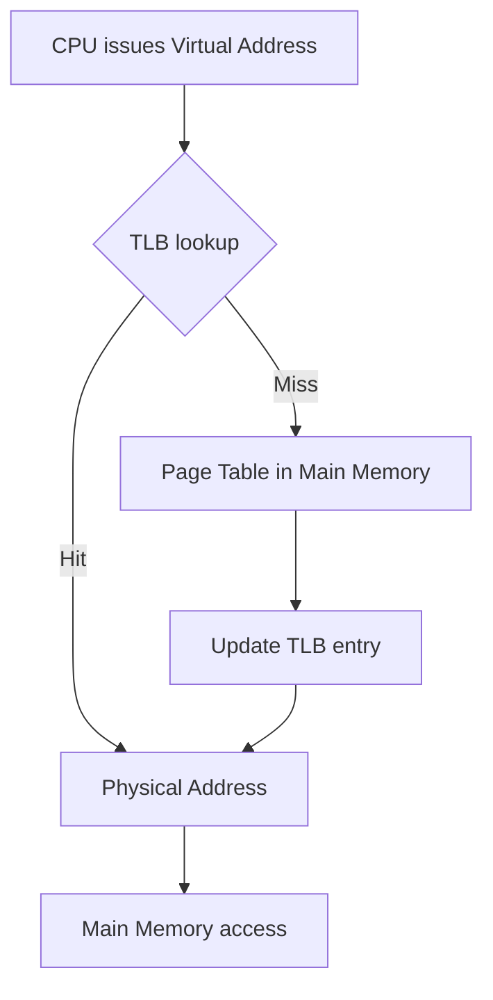
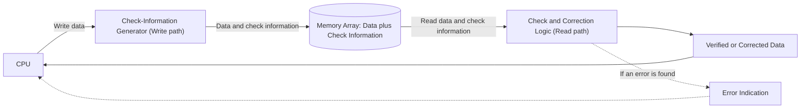
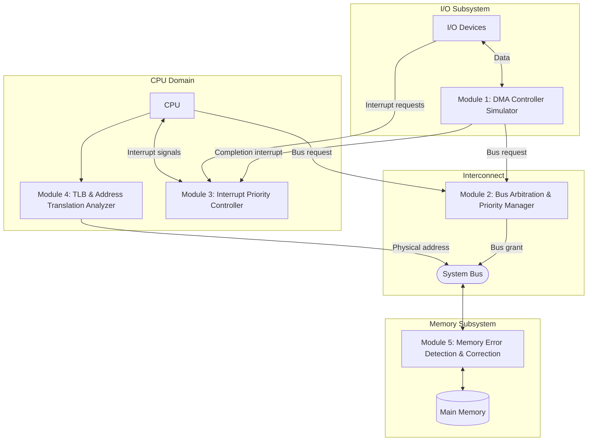
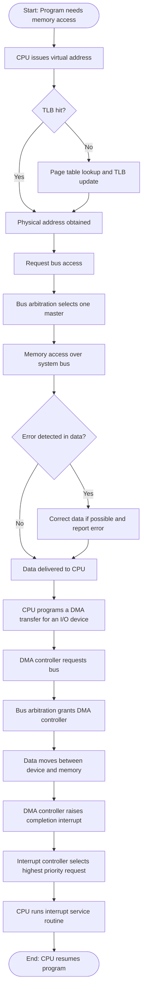

# Computer Architecture Simulator & Analyzer

> A university Computer Architecture project that studies five core hardware and memory-system mechanisms through simulation and analysis.

**Project Status:** Planning / Module Selection Finalized
**Implementation Status:** Not started

---

## Table of Contents

1. [Project Overview](#1-project-overview)
2. [Problem Statement](#2-problem-statement)
3. [Project Objectives](#3-project-objectives)
4. [Final Selected Modules](#4-final-selected-modules)
5. [Individual Module Explanations](#5-individual-module-explanations)
6. [Overall System Architecture](#6-overall-system-architecture)
7. [Overall Working Flow](#7-overall-working-flow)
8. [Relationship Between Modules](#8-relationship-between-modules)
9. [Learning Outcomes](#9-learning-outcomes)
10. [Proposed Development Plan](#10-proposed-development-plan)
11. [Testing Strategy](#11-testing-strategy-planned-not-completed)
12. [Expected Demonstration](#12-expected-demonstration)
13. [Technologies](#13-technologies)
14. [Project Structure](#14-project-structure-conceptual)
15. [Scope and Limitations](#15-scope-and-limitations)
16. [Current Project Status](#16-current-project-status)

---

## 1. Project Overview

Modern computer systems are built from cooperating hardware components: a processor (CPU), a memory hierarchy, input/output (I/O) devices, and a bus that connects them. These components operate at different speeds, compete for shared resources, and must remain correct even when hardware faults occur. Computer Architecture is the discipline that studies how these components are organized and how they interact.

**Computer Architecture Simulator & Analyzer** is a university project that explores this interaction through five carefully selected modules. Each module represents one important hardware or memory-system mechanism:

| # | Module | Architectural Area |
|---|--------|--------------------|
| 1 | DMA Controller Simulator (Direct Memory Access) | I/O and data transfer |
| 2 | Bus Arbitration & Priority Manager | Shared interconnect management |
| 3 | Interrupt Priority Controller | CPU and I/O event handling |
| 4 | TLB & Address Translation Analyzer | Virtual memory and memory hierarchy |
| 5 | Memory Error Detection & Correction | Memory reliability |

Together, the modules cover three broad themes of Computer Architecture:

- **Data movement:** how data travels between devices and memory (Modules 1 and 2).
- **Control and coordination:** how the CPU is notified of events and how shared resources are granted (Modules 2 and 3).
- **Memory system behaviour:** how addresses are translated efficiently and how stored data is protected from faults (Modules 4 and 5).

The project aims to make these normally invisible hardware mechanisms understandable by modelling and analysing them in software.

> **Note:** This document describes the *planned* project. No module has been implemented yet.

---

## 2. Problem Statement

Core hardware mechanisms such as DMA, bus arbitration, interrupt prioritization, address translation, and error correction are usually taught through diagrams and equations. Because these mechanisms operate inside hardware at very high speed, students cannot directly observe them, which makes it difficult to build a clear mental model of how they behave and how their design choices affect system performance and reliability.

This project addresses the problem by planning a software-based environment in which these five mechanisms can be modelled, studied, and analysed in a controlled and observable way.

---

## 3. Project Objectives

- To study and document five important Computer Architecture mechanisms in a clear and consistent manner.
- To show how these mechanisms relate to the CPU, memory, bus, and I/O devices.
- To plan a simulation and analysis environment that supports learning and demonstration.
- To connect theoretical Computer Architecture concepts with observable system behaviour.
- To establish a documented foundation on which detailed features and implementation will be planned later.

---

## 4. Final Selected Modules

The following five modules are finalized for this project.

1. **DMA Controller Simulator (Direct Memory Access)**
2. **Bus Arbitration & Priority Manager**
3. **Interrupt Priority Controller**
4. **TLB & Address Translation Analyzer**
5. **Memory Error Detection & Correction**

---

## 5. Individual Module Explanations

### 5.1 DMA Controller Simulator (Direct Memory Access)

**What the module is.**
A DMA controller is a dedicated hardware unit that transfers blocks of data between an I/O device and main memory without requiring the CPU to move each data item. This module represents that controller in a simulated environment.

**Fundamental Computer Architecture concept.**
Separation of data movement from computation. Without DMA, the CPU performs programmed I/O and spends time copying data word by word. DMA offloads this work so the CPU can perform other tasks.

**Why this module is important.**
Efficient I/O is essential for overall system performance. DMA is used in practically every modern system for disk, network, and graphics transfers, and it is a standard example of how hardware specialization improves CPU utilization.

**General working principle.**
The CPU first provides the DMA controller with the description of a transfer (source, destination, and amount of data). The controller then requests control of the system bus, moves the data between the device and memory, and finally informs the CPU, typically through an interrupt, that the transfer is complete.

**Relation to CPU, memory, bus, and hardware components.**
The DMA controller acts as an alternative bus master. It communicates with the CPU for setup and completion, reads or writes main memory directly, and shares the system bus with the CPU, which is why it is closely connected to bus arbitration (Module 2) and interrupts (Module 3).

**Educational purpose.**
To help students understand the difference between CPU-driven I/O and hardware-assisted I/O, and how a device other than the CPU can take part in memory access.



**Diagram explanation.** The CPU only configures the transfer and is notified at the end (steps 1 and 5). During the transfer itself (steps 2 to 4), the DMA controller communicates directly with memory and the device through the system bus, so the CPU does not handle every data item.

---

### 5.2 Bus Arbitration & Priority Manager

**What the module is.**
Bus arbitration is the mechanism that decides which of several devices that want to use a shared bus at the same time is granted access. This module represents the arbiter and its priority policy in a simulated environment.

**Fundamental Computer Architecture concept.**
Management of a shared resource. A bus can carry only one transfer at a time, so when several bus masters (for example the CPU and a DMA controller) compete, a rule is needed to select exactly one.

**Why this module is important.**
Without arbitration, simultaneous bus use would cause conflicts and corrupted transfers. The arbitration policy also influences fairness, latency, and overall system throughput.

**General working principle.**
Devices that need the bus send a request to the arbiter. The arbiter applies a priority scheme to select one requester and sends it a grant signal. The selected device uses the bus and releases it when finished, after which the arbiter handles the remaining requests.

**Relation to CPU, memory, bus, and hardware components.**
The arbiter sits between the bus masters (such as the CPU and DMA controller) and the shared bus that leads to memory and I/O devices. It does not carry data itself; it controls *who* may do so.

**Educational purpose.**
To teach students why shared interconnects need control logic, and how priority decisions affect the behaviour of the whole system.



**Diagram explanation.** Several masters send requests to the arbiter. The arbiter returns a grant to only one of them at a time. The granted master then uses the shared bus to reach memory or I/O devices.

---

### 5.3 Interrupt Priority Controller

**What the module is.**
An interrupt controller collects interrupt requests from hardware devices and presents them to the CPU in an organized way, using priorities to decide which request is served first. This module represents that controller in a simulated environment.

**Fundamental Computer Architecture concept.**
Asynchronous event handling. Instead of the CPU repeatedly checking whether a device needs attention (polling), devices signal the CPU only when an event occurs. When several signals arrive together, priority determines the order of service.

**Why this module is important.**
Interrupts allow the CPU to remain productive while still responding to time-critical events such as keyboard input, timers, disk completion, and DMA completion. Correct prioritization ensures that urgent events are not delayed by less important ones.

**General working principle.**
Devices raise interrupt request signals. The controller determines which pending request has the highest priority and signals the CPU. The CPU suspends its current work, executes the corresponding interrupt service routine, and then resumes the interrupted program.

**Relation to CPU, memory, bus, and hardware components.**
The controller connects multiple I/O devices to a single interrupt input of the CPU. The CPU uses information from the controller to locate the correct service routine in memory.

**Educational purpose.**
To help students understand the difference between polling and interrupt-driven operation, and how priority resolves competing events.



**Diagram explanation.** Multiple devices raise interrupt requests (IRQ). The controller forwards only the highest-priority one to the CPU. The CPU acknowledges it, runs the corresponding service routine, and then returns to the interrupted program.

---

### 5.4 TLB & Address Translation Analyzer

**What the module is.**
In a virtual memory system, programs use virtual addresses that must be translated into physical memory addresses. The Translation Lookaside Buffer (TLB) is a small, fast cache of recent translations. This module represents the translation process and the TLB in a simulated environment, with an emphasis on analysing its behaviour.

**Fundamental Computer Architecture concept.**
Virtual memory and caching of translations. Address translation normally requires consulting page tables stored in main memory, which is slow. The TLB exploits locality of reference so that most translations can be completed quickly.

**Why this module is important.**
Every memory access in a virtual-memory system requires translation, so the speed of translation strongly affects overall performance. The TLB is a key reason virtual memory is practical.

**General working principle.**
The CPU issues a virtual address. The system first checks the TLB. If the translation is present (a hit), the physical address is obtained immediately. If it is absent (a miss), the page table is consulted, the translation is obtained, and the TLB is updated for future accesses. The resulting physical address is then used to access memory.

**Relation to CPU, memory, bus, and hardware components.**
The translation hardware sits between the CPU and the memory system. The TLB is a small hardware cache close to the CPU, while the page tables reside in main memory.

**Educational purpose.**
To allow students to understand how virtual addresses become physical addresses and how hit and miss behaviour influences memory access time.



**Diagram explanation.** A virtual address first goes to the TLB. A hit gives the physical address immediately. A miss forces a slower page-table lookup, after which the TLB is updated. In both cases the physical address is finally used to access main memory.

---

### 5.5 Memory Error Detection & Correction

**What the module is.**
Stored or transmitted data can be corrupted by hardware faults or interference. Error detection and correction techniques add redundant information to data so that corruption can be detected and, in some cases, repaired. This module represents such a mechanism for memory in a simulated environment.

**Fundamental Computer Architecture concept.**
Reliability through redundancy. By storing additional check information along with data, a memory system can verify its contents when they are read.

**Why this module is important.**
Memory faults can silently change program data or instructions. Error-protected memory, such as ECC memory, is widely used where correctness matters, including servers and critical systems.

**General working principle.**
When data is written, check information is generated from it and stored alongside it. When the data is read back, the check information is recomputed and compared. A mismatch reveals an error, and depending on the technique used, the error location can be identified and the data corrected.

**Relation to CPU, memory, bus, and hardware components.**
The mechanism operates in the memory subsystem, between the memory storage and the data path that returns information to the CPU. The CPU receives corrected data or an error indication.

**Educational purpose.**
To help students understand the idea of redundancy and the difference between detecting an error and correcting it.



**Diagram explanation.** On a write, check information is generated and stored with the data. On a read, the logic recomputes and compares it. The CPU receives verified or corrected data, and an error indication is raised when a problem was found.

---

## 6. Overall System Architecture

The diagram below shows how the five modules fit into a conceptual computer system. It shows the *relationships between modules and hardware components*, not an implementation design.



**Diagram explanation.** The CPU domain contains the CPU, address translation (Module 4), and interrupt handling (Module 3). The interconnect contains the arbiter (Module 2) and the bus. The memory subsystem protects main memory (Module 5). The I/O subsystem contains the DMA controller (Module 1) and devices. The CPU and DMA controller compete for the bus through the arbiter; translated addresses reach memory through the bus; devices and the DMA controller notify the CPU through the interrupt controller.

---

## 7. Overall Working Flow

The diagram below follows one conceptual scenario that touches all five modules: a program accesses memory, a device then requests a data transfer, and the CPU is notified when the transfer is finished.



**Diagram explanation.** The flow reads from top to bottom. Address translation (Module 4) comes first. Bus arbitration (Module 2) decides who may use the bus for the memory access. The data read is checked by error detection and correction (Module 5). Afterwards a DMA transfer (Module 1) is arranged, again requiring arbitration, and its completion is reported through the interrupt controller (Module 3).

---

## 8. Relationship Between Modules

The five modules are independent topics but are naturally connected through the shared resources of a computer system.

| Module | Interacts with | Nature of the relationship |
|--------|----------------|----------------------------|
| DMA Controller Simulator | Bus Arbitration & Priority Manager | DMA is a bus master and must obtain bus access. |
| DMA Controller Simulator | Interrupt Priority Controller | DMA signals the CPU through an interrupt when a transfer is complete. |
| DMA Controller Simulator | Memory Error Detection & Correction | Data written or read by DMA passes through the protected memory subsystem. |
| Bus Arbitration & Priority Manager | Interrupt Priority Controller | Both apply priority rules, but to different resources (bus access versus CPU attention). |
| TLB & Address Translation Analyzer | Memory Error Detection & Correction | Translated physical addresses lead to memory accesses whose data is verified. |
| TLB & Address Translation Analyzer | Bus Arbitration & Priority Manager | Memory accesses that follow translation require the bus. |

This shows that the modules together form a coherent view of the data path, control path, and memory path of a computer system.

---

## 9. Learning Outcomes

After completing the project, the team expects to be able to:

- Explain how DMA reduces CPU involvement in I/O transfers.
- Describe why shared buses require arbitration and how priority affects access.
- Distinguish polling from interrupt-driven operation and explain interrupt prioritization.
- Explain virtual-to-physical address translation and the role of the TLB.
- Explain the principle of redundancy in error detection and correction.
- Relate all five mechanisms to the CPU, memory, bus, and I/O organization of a computer system.
- Document a technical project clearly using diagrams and structured explanations.

---

## 10. Proposed Development Plan

The plan is intentionally high-level. Detailed tasks, features, and schedules will be defined later.

| Phase | Description | Status |
|-------|-------------|--------|
| 1 | Module selection and conceptual documentation | Completed (this document) |
| 2 | Feature planning and requirements per module | Not started |
| 3 | Technology and design decisions | Not started (TBD) |
| 4 | Implementation of modules | Not started |
| 5 | Integration of modules | Not started |
| 6 | Testing and evaluation | Not started |
| 7 | Final documentation and demonstration preparation | Not started |

Task allocation among team members and calendar deadlines are TBD.

---

## 11. Testing Strategy (Planned, Not Completed)

No testing has been performed because nothing has been implemented. The following approach is planned:

| Test Level | Planned Purpose |
|------------|-----------------|
| Module-level verification | Check each module's behaviour against the theoretical concept it represents. |
| Integration verification | Check that modules interact consistently where relationships exist (see Section 8). |
| Scenario-based validation | Run the conceptual workflow from Section 7 as an end-to-end scenario. |
| Review against references | Compare observed behaviour with textbook descriptions. |

Test cases, tools, and acceptance criteria are TBD.

---

## 12. Expected Demonstration

The final demonstration is expected to:

- Briefly introduce each of the five modules and its architectural role.
- Present the system architecture and working flow diagrams.
- Show each module's behaviour in a prepared scenario.
- Show how the modules relate through the end-to-end scenario described in Section 7.

The exact demonstration format and scenarios are TBD. No screenshots or results exist at this stage.

---

## 13. Technologies

No technologies have been confirmed yet.

| Area | Choice |
|------|--------|
| Programming language | TBD |
| User interface / visualization | TBD |
| Libraries / frameworks | TBD |
| Build and run environment | TBD |
| Version control and collaboration | TBD |
| Testing tools | TBD |

*Documentation uses Markdown and Mermaid diagrams.*

---

## 14. Project Structure (Conceptual)

The structure below is a conceptual plan and may change once technology and design decisions are made.

```text
computer-architecture-simulator-analyzer/
├── README.md
├── docs/                      # Additional documentation (TBD)
├── modules/
│   ├── dma-controller/                 # Module 1
│   ├── bus-arbitration/                # Module 2
│   ├── interrupt-controller/           # Module 3
│   ├── tlb-address-translation/        # Module 4
│   └── memory-error-correction/        # Module 5
├── integration/               # Combined system (TBD)
└── tests/                     # Tests (TBD)
```

---

## 15. Scope and Limitations

**In scope**

- The five finalized modules listed in Section 4.
- Conceptual documentation, diagrams, and planning for these modules.
- Educational modelling of hardware concepts in software (planned).

**Out of scope / limitations**

- No other modules will be added beyond the five finalized ones.
- The project is educational and does not aim to reproduce any specific commercial processor or hardware product.
- Detailed features, level of simulation accuracy, and performance targets are TBD.
- Current documentation describes concepts only; nothing is implemented.

---

## 16. Current Project Status

| Item | Status |
|------|--------|
| Overall status | Planning / Module Selection Finalized |
| Module selection | Finalized (five modules) |
| Conceptual documentation | Completed in this README |
| Feature planning | Not started |
| Technology selection | TBD |
| Implementation | Not started |
| Testing | Not started |
| Demonstration | Not started |

| Module | Implementation Status |
|--------|-----------------------|
| DMA Controller Simulator (Direct Memory Access) | Not started |
| Bus Arbitration & Priority Manager | Not started |
| Interrupt Priority Controller | Not started |
| TLB & Address Translation Analyzer | Not started |
| Memory Error Detection & Correction | Not started |
